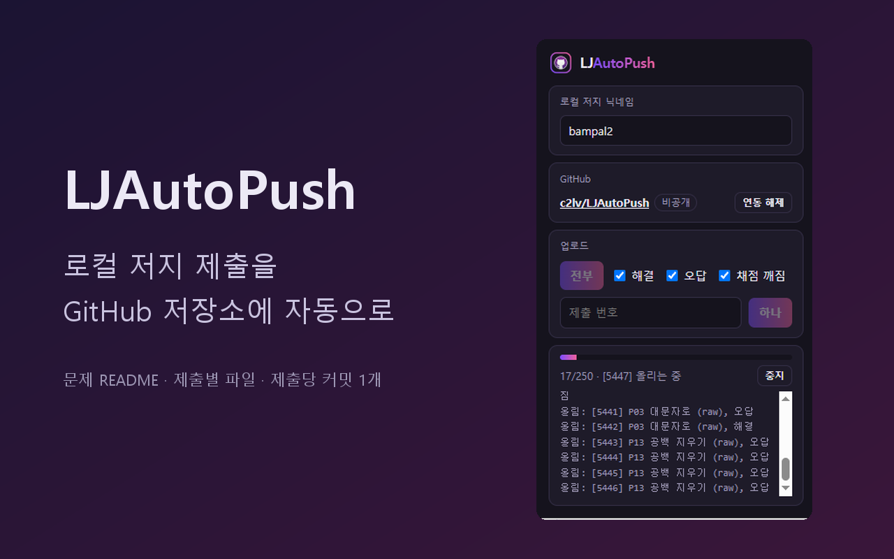

# LJAutoPush



[로컬 저지](https://localjudge.com/)에 낸 제출을 GitHub 저장소 `LJAutoPush`에 올리는 크롬 익스텐션입니다. 서버 없이 브라우저 안에서만 동작합니다.

## 사용

1. 로컬 저지에 로그인한 탭에서 익스텐션 아이콘을 누릅니다.
2. 닉네임을 확인하고 **GitHub 연동**을 누릅니다. 닉네임 칸이 비어 있으면 로그인한 계정으로 채워집니다.
3. 표시된 코드를 복사해 GitHub 화면에 입력하고 승인합니다. 비공개 저장소 `LJAutoPush`가 만들어집니다.
4. 올립니다.
   - **전부**: 체크한 결과(해결 / 오답 / 채점 깨짐)의 내 제출을 모두 올립니다. 이미 올라간 제출은 건너뜁니다.
   - **하나**: 입력한 제출 번호 하나만 올립니다. 이미 있으면 덮어씁니다.

업로드는 로컬 저지 탭 안에서 돌아갑니다. 팝업은 닫아도 되지만 그 탭은 열어 두어야 합니다. 익스텐션을 설치하거나 갱신한 직후에는 로컬 저지 탭을 한 번 새로고침하세요.

## 검증 자동화

로컬 저지 [검증](https://localjudge.com/verify) 화면에서 하는 일을 대신 해 줍니다. 로컬 저지에 로그인만 되어 있으면 되고, 닉네임 입력과 GitHub 연동은 필요 없습니다.

제출 내역에서 체크한 결과(해결 / 오답 / 채점 깨짐)의 최신 제출부터 n개를 검증합니다. 문제 번호를 넣으면 그 문제로 좁힙니다.

팝업의 **검증** 칸에서 결과를 체크하고 개수를 넣은 뒤 **검증**을 누릅니다. 새 탭에 검증 화면이 열리고, 제출마다 번호를 넣어 **불러오기** → **내 기기에서 다시 돌리기**를 누른 뒤 결과(출력 일치, 내 기기에서 통과)를 팝업 기록에 남깁니다.

예시:

- 최근 해결 20개: 해결만 체크, 문제 번호 비움, 20개
- 최근 오답과 채점 깨짐 10개: 오답·채점 깨짐 체크, 10개
- P13의 최근 제출 5개: 세 결과 모두 체크, 문제 번호 `P13`, 5개

검증할 수 없는 제출은 불러오기 전에 걸러 냅니다.

- 파이썬·자바스크립트·SQL 같은 코드 문제: 검증 화면이 모델 문제만 다시 돌립니다.
- 내가 풀지 않은 문제, 낸 분이 전체 비공개로 둔 제출: 프롬프트가 보이지 않습니다.
- 내 제출

### 조회 한도

검증 화면의 **불러오기**는 한 시간에 약 20번까지만 됩니다. 넘으면 "조회가 너무 잦습니다. N분 뒤에 다시 해주세요."가 나오고 한 시간 가까이 막힙니다.

- 한 번에 최대 20개까지 검증합니다.
- **다시 돌리기**에도 따로 제한이 있습니다. 넘으면 "검증이 너무 잦습니다. N분 뒤에 다시 해주세요."가 나옵니다.
- 두 제한 메시지 중 하나라도 나오면 그 자리에서 멈추고, 몇 분 뒤에 다시 실행하면 되는지 알려 줍니다.

### 그 밖에

- 최근 제출은 2,000건(40쪽)까지 살펴봅니다.
- 모델이 내 브라우저에서 돌아가므로 제출 하나에 수십 초에서 몇 분이 걸립니다. 처음에는 모델을 내려받느라 더 걸립니다.
- 끝날 때까지 검증 탭을 닫거나 다른 탭으로 옮기지 마세요. 뒤로 숨은 탭은 브라우저가 느리게 돌립니다.
- 로컬 저지는 누가 검증했는지 공개하지 않고, 익스텐션도 검증 기록을 따로 남기지 않습니다. 그래서 전에 검증한 제출을 다시 고를 수 있습니다.
- **중지**를 누르면 지금 돌고 있는 제출까지 마치고 멈춥니다.

## 저장 구조

```
로컬 저지/
  P01 덧셈 (raw)/
    README.md        문제, 입력·출력 조건, 요구사항, 예시, 참고 사항, 분류
    3154.md          제출 정보와 프롬프트(코드)
README.md
```

- 문제 `README.md`는 그 폴더에 없을 때만 만듭니다. 제출 정보는 넣지 않습니다.
- 제출 파일에는 결과, 채점, 제출 번호, 제출 시각, 길이, 푸는 데, 가장 작은 마진, 걸린 시간, 돌린 환경, 프롬프트(코드) 본문이 들어갑니다.
- 파이썬 문제도 `.md`로 저장합니다.
- 제출 1건이 커밋 1개입니다. 커밋 메시지: `[3154] P01 덧셈 (raw), 해결 - LJAutoPush`

## 권한과 데이터

| 권한 | 쓰는 곳 |
| --- | --- |
| `storage` | 닉네임, GitHub 토큰, 체크박스 상태, 진행 상태 저장 |
| `activeTab` | 현재 탭이 로컬 저지인지 확인 |
| `https://localjudge.com/*` | 제출 내역, 제출, 문제 화면 읽기 |
| `https://api.github.com/*` | 저장소 생성과 커밋 |
| `https://github.com/login/*` | Device Flow 인증 |

- GitHub 토큰은 이 브라우저의 `chrome.storage.local`에만 저장됩니다. **연동 해제**를 누르면 지워집니다.
- 데이터는 로컬 저지와 GitHub로만 오갑니다. 개발자 서버는 없습니다.
- 토큰 범위는 `repo`입니다. 비공개 저장소를 만들고 커밋하는 데 필요합니다.

## 주의

- 로컬 저지는 프롬프트 본문을 그 문제를 푼 사람에게만 보여 줍니다. 저장소를 공개로 바꾸면 풀이가 드러납니다.
- 제출이 많으면 GitHub 요청 제한에 걸릴 수 있습니다. 그때는 자동으로 기다렸다가 이어서 올립니다. 중간에 끊겨도 **전부**를 다시 누르면 남은 것만 올립니다.
- 로컬 저지 화면 구조가 바뀌면 읽기에 실패할 수 있습니다.

## 개발

### 구성

| 파일 | 역할 |
| --- | --- |
| `manifest.json` | Manifest V3 설정 |
| `config.js` | Client ID, 저장소 이름, 최상위 폴더 이름 |
| `background.js` | Device Flow 인증, 저장소 생성, GitHub API 호출 |
| `parser.js` | 로컬 저지 화면을 마크다운으로 변환 |
| `content.js` | 제출 수집과 업로드 실행 (로컬 저지 탭) |
| `verify.js` | 검증 자동화 (팝업이 연 검증 탭) |
| `popup.html` `popup.css` `popup.js` | 팝업 |
| `icons/` | 아이콘 |

### 직접 빌드해 쓰기

1. GitHub OAuth App을 만듭니다. <https://github.com/settings/developers> → **New OAuth App**
   - Homepage URL, Authorization callback URL: 이 익스텐션의 소스 저장소 주소. Device Flow는 callback을 호출하지 않지만 필수 칸입니다.
   - 만든 뒤 **Enable Device Flow**를 체크하고 저장합니다.
2. 발급된 **Client ID**를 `config.js`의 `CLIENT_ID`에 넣습니다. client secret은 쓰지 않으며, Client ID는 공개돼도 됩니다.
3. `chrome://extensions` → 개발자 모드 → **압축해제된 확장 프로그램을 로드합니다** → 이 폴더 선택.


## 라이선스

[MIT](LICENSE)

[BaekjoonHub](https://github.com/BaekjoonHub/BaekjoonHub)를 참고했습니다.
